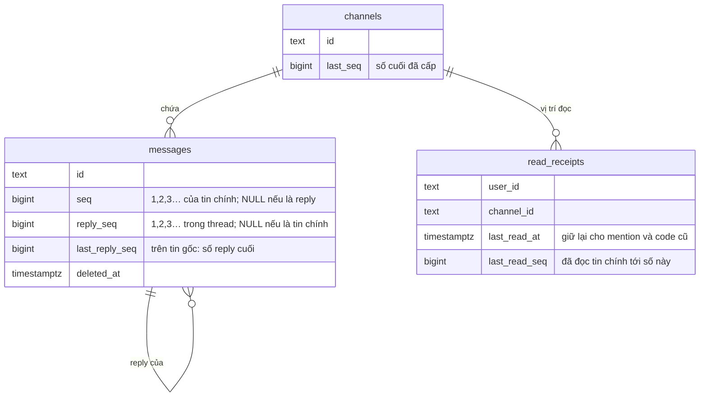
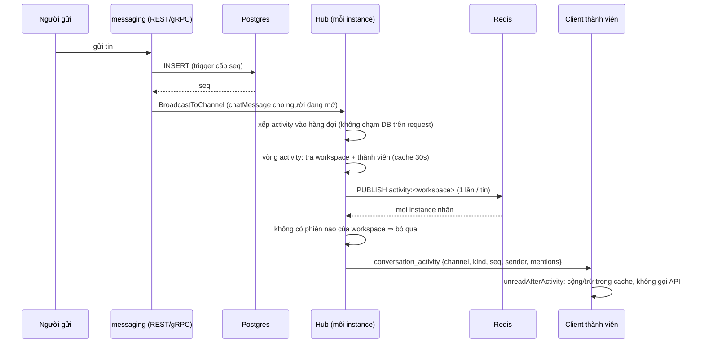

# Tin nhắn ở quy mô lớn: đếm chưa đọc theo số thứ tự, badge realtime, phân trang theo số

Tài liệu kiến trúc cho thay đổi trên nhánh `feat/message-unread-seq` (plan
`plans/261106-2127-message-unread-seq-at-scale/`). Hành vi được cam kết nằm ở spec
`docs/specs/chat-unread-counts/spec.md`; tài liệu này giải thích vì sao và bằng cách nào.

## 1. Bài toán

Hệ thống phục vụ nhiều công ty (tenant) trên một Postgres, một bảng `messages` chung. Câu hỏi đặt ra: khi có
hàng nghìn công ty và lượng tin nhắn rất lớn, phần nào của việc tải tin nhắn vỡ trước?

Đọc lịch sử không phải chỗ vỡ đầu tiên: một trang 50 tin đi qua index `(channel_id, created_at)`, chi phí cố định
dù channel dài bao nhiêu. Chỗ vỡ trước là **số chưa đọc**:

1. **Đếm bằng `COUNT(*)`.** Số tin chính chưa đọc của mỗi channel được đếm từng dòng sau `last_read_at`. Người chưa
   từng đọc một channel một triệu tin khiến mỗi lần đếm quét một triệu dòng.
2. **Đếm lại sau mỗi tin.** Client nhận tin của channel đang mở rồi gọi lại `GET /api/channels/unread` — câu
   SQL lớn trên mọi channel người đó đọc được, kèm một lần kiểm NGAC theo lô. Channel có N người đang mở ⇒ mỗi tin
   gây N lần như vậy.
3. **Badge của channel không mở không cập nhật realtime.** Sự kiện `unreadCount` có trong proto nhưng server không
   bao giờ gửi; thanh bên chỉ đúng lại khi mở app hoặc reconnect.

Các vấn đề phụ: cursor phân trang chỉ theo `created_at` (hai tin cùng micro giây ở ranh giới trang thì mất một),
thread trả mọi reply trong một request, cache lịch sử phía client chỉ lớn thêm.

## 2. Hướng đã chọn

Ba hướng đã được so sánh (`plans/reports/brainstorm-261106-2130-message-loading-at-scale.md`):

| Hướng | Nội dung | Vỡ khi |
|---|---|---|
| **A (đã làm)** | Sửa trên Postgres: số thứ tự theo channel, đếm bằng phép trừ, đẩy delta qua websocket | Một primary không chịu nổi lượng ghi hoặc dung lượng |
| B | A + partition/shard theo tenant (Citus), search engine riêng | Một tenant khổng lồ thành hot shard; vận hành nặng |
| C | Kho tin nhắn riêng (ScyllaDB/Cassandra) | Mất join/transaction với Postgres; viết lại lớn |

A xử lý đúng những điểm vỡ đầu tiên, rẻ nhất, và các cột nó thêm cũng là thứ B cần — không bị bỏ đi khi lên B.

## 3. Mô hình dữ liệu



Migration `data/migrations/072_message_sequences.sql` (một transaction) thêm cột, trigger và backfill;
`073_message_sequence_indexes.sql` dựng index `CONCURRENTLY`:

| Index | Dùng cho |
|---|---|
| `messages_channel_seq` UNIQUE `(channel_id, seq DESC) WHERE parent_message_id IS NULL` | Trang lịch sử; bảo đảm một số chỉ cấp một lần |
| `messages_deleted_seq` `(channel_id, seq) WHERE … deleted_at IS NOT NULL` | Trừ tin đã xoá khi đếm (ít dòng) |
| `messages_thread_reply_seq` UNIQUE `(parent_message_id, reply_seq)` | Trang thread |

### 3.1 Cấp số bằng trigger

`messages_number` (BEFORE INSERT) chạy trong transaction chèn tin:

1. Tin có id đã tồn tại ⇒ bỏ qua dòng trước khi lấy số (giữ hành vi `ON CONFLICT DO NOTHING` mà không để lỗ).
2. Tin chính: `UPDATE channels SET last_seq = last_seq + 1 … RETURNING` ⇒ `NEW.seq`. Dòng channel bị khoá tới
   commit, nên người gửi đồng thời trong một channel lần lượt lấy số; transaction rollback thì số rollback theo.
   Không có lỗ, không trùng.
3. Người gửi đã đọc tới ngay trước tin này ⇒ vị trí đọc của họ tiến tới tin của chính họ.
4. Reply: tương tự trên dòng tin gốc (`last_reply_seq`).

Vì sao trigger thay cho code Go: mọi đường chèn tin (gửi, thẻ cuộc gọi, tin hệ thống, code bản cũ còn chạy trong
lúc deploy hoặc sau rollback) đều có số, không cần nhớ sửa từng chỗ.

`read_receipts_number` (BEFORE INSERT/UPDATE): một lần ghi chỉ đổi `last_read_at` mà không đổi `last_read_seq` —
tức code chỉ biết thời gian — được gán số của tin chính cuối cùng tại hoặc trước thời điểm đó. Nhờ vậy bản cũ chạy
song song hay sau rollback cũng không làm vị trí đọc lệch.

### 3.2 Backfill và an toàn khi deploy

- Đánh số theo `created_at, id` những dòng chưa có số, nối tiếp số đã có; tính `last_read_seq` từ `last_read_at`.
  Chạy lại lần hai không đổi gì (`make db-migrate` chạy lại mọi file).
- `SET LOCAL lock_timeout = '5s'`: các `ALTER` giữ khoá độc quyền tới commit; nếu có truy vấn dài đang chạy,
  migration bỏ cuộc thay vì xếp mọi truy vấn chat sau nó. Lần deploy sau thử lại.
- 073 xoá trước bản index INVALID do lần build hỏng để lại, và kết thúc bằng kiểm tra: thiếu hoặc INVALID ⇒ báo lỗi,
  runner không ghi nhận đã áp.
- Đảo ngược: SQL trong đầu file 072 (bỏ trigger, ràng buộc, cột; index của 073 đi theo cột).
- Kiểm bằng `scripts/test-migration-072.sh` trên bản sao của DB test.

## 4. Đếm chưa đọc

```
unread_main = max(0, channels.last_seq − read_receipts.last_read_seq
                     − #{tin chính đã xoá có seq > last_read_seq})      (0 khi mức thông báo là off)
```

- Chi phí mỗi channel: hai lần đọc theo khoá chính và một lần đếm trên index tin đã xoá (rất ít dòng). Không phụ
  thuộc độ dài lịch sử hay tổng tin của nền tảng.
- **Đánh dấu đã đọc** (`POST /api/channels/{id}/read`): `last_read_seq = channels.last_seq` lúc đó. Tin đang được
  chèn (chưa commit) giữ số chưa thấy nên vẫn là chưa đọc — đúng hơn cách cũ theo `NOW()`.
- **Đánh dấu chưa đọc**: `last_read_seq = seq − 1` của tin được chọn.
- **Mention chưa đọc**: tin chính nhắc tới người đọc có `seq > last_read_seq`, hoặc được thêm mention bằng một lần
  sửa sau `last_read_at`.
- **Reply chưa đọc** vẫn đếm theo thời gian trong từng thread theo dõi: một thread nhỏ, chi phí đã có giới hạn.
- Mỗi dòng trả về mang `last_seq` và `last_read_seq` để client đếm tiếp.

## 5. Badge realtime



### 5.1 Server

- `ConversationActivityEvent` (`ws.proto`): `channel_id`, `kind` (`sent`/`deleted`), `seq`, `root_message_id`,
  `sender_id`, `mentions`, `last_seq`. **Không có nội dung.**
- Phát cho mọi phiên của mọi thành viên, mở channel hay không; không cho người ngoài, không cho cùng người đăng nhập
  workspace khác.
- Thành viên lấy từ cache `channel_members` (như push notification). Instance nhớ danh sách mỗi channel tối đa 30
  giây; gỡ thành viên (`revokeLocal`) hoặc rời workspace (`revokeWorkspaceLocal`) xoá ngay, và một lần đọc danh sách
  đang diễn ra lúc gỡ không được lưu (bộ đếm thế hệ).
- Một goroutine `runActivity` vừa publish vừa giao, có hàng đợi 4.096; đầy thì bỏ sự kiện — client thấy lỗ số và
  tự hỏi lại.
- Tắt bằng `MESSAGING_ACTIVITY_EVENTS=0`.

### 5.2 Client (`frontend/src/lib/unread-activity.ts`)

| Sự kiện | Kết quả |
|---|---|
| Tin chính của người khác, channel không đang xem | `unread_count + 1` (trừ mức off), `mention_count + 1` nếu nhắc tới mình |
| Tin của chính mình, hoặc channel đang xem | chỉ nhớ `last_seq` |
| Số đã đếm | bỏ qua |
| Nhảy số (lỗ) / channel chưa biết | đếm, rồi hỏi lại server một lần |
| Xoá tin có `seq > last_read_seq` | `unread_count − 1`; hỏi lại nếu đang hiện mention |
| Reply | để `ThreadStateEvent` lo; channel ở mức `all` thì hỏi lại |

Tin trong channel đang mở không còn gọi lại API.

### 5.3 Vì sao chỉ thành viên nhận, và giới hạn

Nội dung luôn đọc qua endpoint đã kiểm `read` NGAC trên OA của channel. Sự kiện chỉ lộ: có hoạt động, ai gửi, ai
được nhắc. Cache `channel_members` có thể sống lâu hơn quan hệ NGAC (xoá cache thất bại, đổi graph ngoài
messaging); khi đó người đó vẫn nghe hoạt động tới khi dòng cache mất. Đây là cùng mức tin cậy push notification
đang dùng, và được ghi trong spec.

## 6. Phân trang

- **Lịch sử:** `GET /api/channels/{id}/messages?before_seq=N` — tin chính số nhỏ hơn N, mới trước, tối đa 50.
  Trang nối nhau chính xác. `before=<thời gian>` vẫn nhận cho client cũ.
- **Thread:** `GET /api/messages/{id}/thread?after_reply_seq=N&limit=` — gốc + tối đa 200 reply, cũ trước,
  `has_more`. Màn thread đọc lần lượt mọi trang nên vẫn hiện cả thread, nhưng không request nào lớn theo độ dài thread.
- **Cache client:** rời một channel chỉ giữ 100 tin mới nhất; cuộn lên lại thì tải lại.
- Tin live mang `seq` để cursor luôn có.
- Ba chỗ trước đây tải cả thread chỉ để lấy một tin (danh sách ghim, thẻ cuộc gọi, tin vừa sửa) dùng `GetMessage`.

## 7. Reconnect

Sau khi rớt socket, client chờ một khoảng ngẫu nhiên trải trên cả bước backoff: tới 5 giây lần đầu, gấp đôi mỗi
lần, tối đa 30 giây, tối thiểu 250 ms. Deploy làm rớt mọi socket cùng lúc thì các phiên quay lại trải đều nhiều giây.
Resync sau reconnect vốn đã gọn (TanStack chỉ refetch query đang hiển thị; chat state trả 304 khi không đổi).

## 8. Số đo

Đo trên `ngac_bench` (Postgres 16 Docker local): 2.000 tenant, 50 triệu tin, một channel toàn công ty 1 triệu tin;
một người xem đọc 201 channel. Chi tiết: `plans/261106-2127-message-unread-seq-at-scale/reports/results.md`.
Chạy lại: `make bench-messages`.

| Đếm chưa đọc (201 channel) | Trước | Sau |
|---|---|---|
| 1 lần gọi, mức thường: p50 / p95 | 236 / 308 ms | **6,2 / 12,1 ms** |
| 1 lần gọi, gồm người ở mức `all`: p95 | 414 ms | 156 ms |
| 50 client đồng thời: lượt/giây | 24 | 440 |

Phần lớn mức giảm ở người dùng thường đến từ đếm mention: truy vấn cũ để planner kết hợp index channel (1,48 triệu
dòng mỗi lần) với index `mentions`; truy vấn mới đi từ index `mentions` trước (CTE `MATERIALIZED`). Phép trừ cho tin
chính bỏ phần chi phí theo số tin chưa đọc. Đuôi còn lại là người ở mức `all` với hàng chục nghìn reply chưa đọc.

Trang lịch sử: p95 45,7 → 28,8 ms dưới 50 client (một lần gọi 2,9 ms). Hub: phát một tin tới 1.000 phiên mất
~125 µs. Tìm kiếm (p95 1 s với từ hiếm, 45 s với từ phổ biến) không đổi: nằm ngoài hướng A.

Migration trên 50 triệu dòng: 072 mất 2 giờ 44 phút và giữ khoá bảng suốt thời gian đó, 073 mất 5 phút. Prod hiện
nhỏ nên không đáng kể; với bảng lớn phải backfill theo lô (xem mục 9).

## 9. Quyết định và phần để lại

| Quyết định | Lý do |
|---|---|
| Bỏ `messages.workspace_id` | Bản sao lệch khi channel đổi workspace; khoá ngoại chặn xoá workspace; không acceptance nào cần |
| Vị trí đọc thread vẫn theo thời gian | Một thread nhỏ; số reply chỉ dùng để phân trang |
| Không thu hẹp truy vấn ghim | Mỗi channel ít ghim; không có số đo cho thấy tốn |
| Để lại subscribe Redis theo nhu cầu | Prod một instance nên không có lợi; mở khe mất tin giữa SUBSCRIBE và tin đầu tiên. Làm khi chạy ≥ 2 instance |
| Không đổi khung đánh giá NGAC | Nội dung vẫn kiểm trên OA của channel; sự kiện chỉ mang id |

Rủi ro còn lại:

- Khoá dòng `channels` khi cấp số: tin trong một channel ghi tuần tự.
- Reply chưa đọc ở mức `all` vẫn đếm theo số dòng reply (p95 156 ms khi người đó có 50k reply chưa đọc).
- Backfill 072 một khối: 2 giờ 44 phút khoá bảng trên 50 triệu dòng. Áp cho một DB lớn phải tách thành lô.
- Lần đo 5 triệu tin để chứng minh "không đổi theo số tin" chưa chạy; lập luận dựa trên cấu trúc truy vấn.
- E2E hai người cho badge chưa chạy; có test đơn vị ở cả server và client.
- Nhiều instance: sự kiện tới không theo thứ tự sẽ gây hỏi lại; khi đó nên thêm cửa sổ chờ sắp xếp.
- Package test `internal/domain` chạy gần giới hạn 60 giây của `make test`.

## 10. Vận hành

- Deploy: migration 072 chạy trong transaction (có `lock_timeout`), 073 ngoài transaction. Code bản cũ phục vụ
  trong lúc đó vẫn đúng nhờ hai trigger.
- Rollback code: không cần đảo migration; trigger giữ vị trí đọc đúng.
- Tắt badge realtime: `MESSAGING_ACTIVITY_EVENTS=0` cho service messaging; client vẫn đúng nhờ hỏi lại khi reconnect.
- Đảo migration: SQL trong đầu 072.

## 11. Lộ trình tiếp (hướng B)

Khi số đo cho thấy một primary không đủ: partition `messages` theo workspace (hash) rồi Citus với khoá phân tán là
workspace; tìm kiếm chuyển sang OpenSearch/Meilisearch qua Redpanda; subscribe Redis theo nhu cầu và cửa sổ sắp
xếp sự kiện khi chạy nhiều instance. `seq` và `last_read_seq` giữ nguyên nghĩa trong mọi bước đó.
